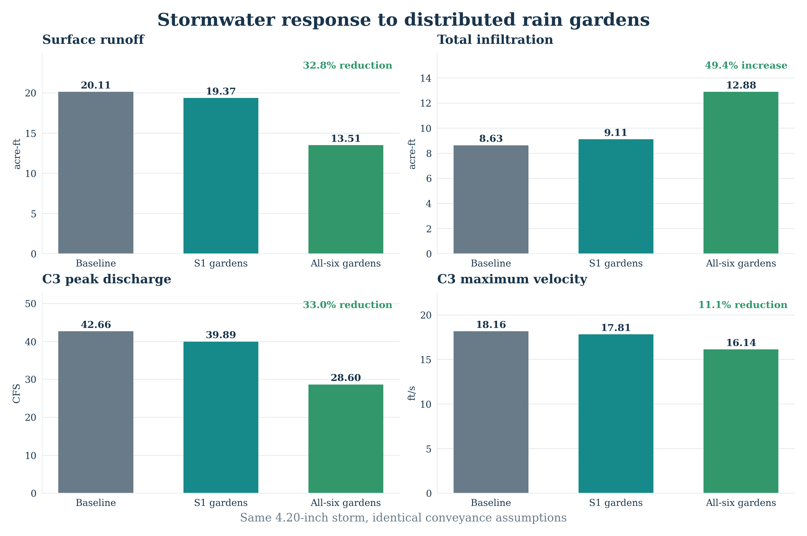
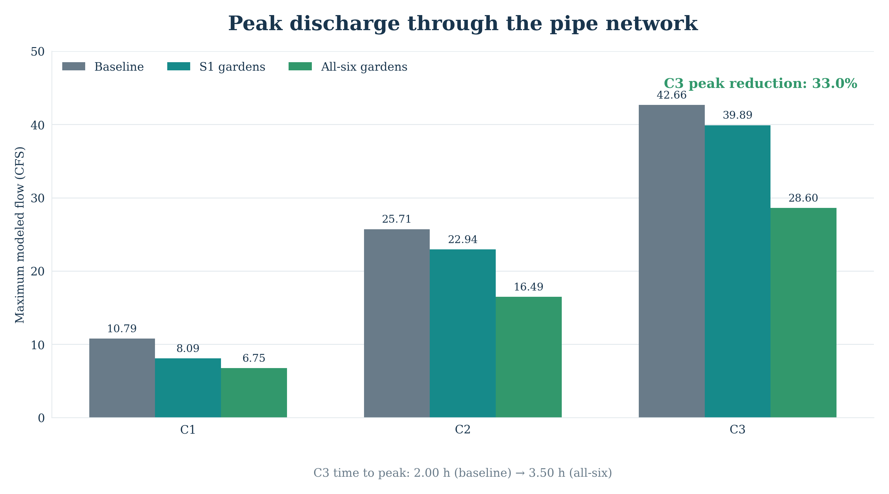
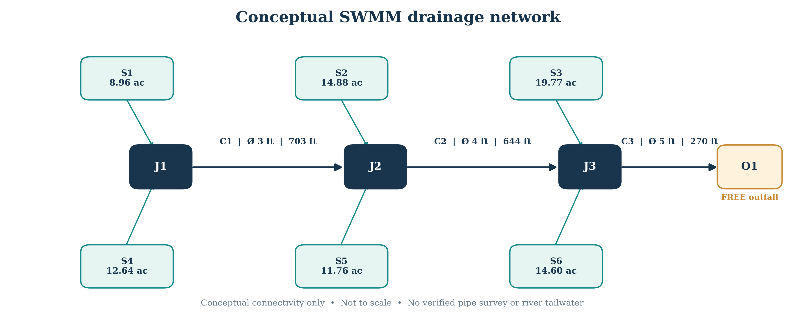
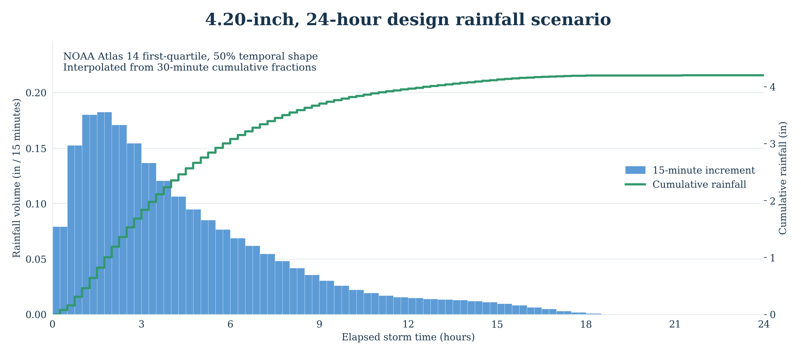

# Minneapolis Stormwater: Baseline vs. Green Infrastructure

**A GIS-assisted, conceptual stormwater modeling project using EPA SWMM 5.2.4.**

This project evaluates how distributed rain gardens could change runoff from an approximately **82.61-acre** urban drainage area near the Mississippi River in Minneapolis, Minnesota. Three scenarios use identical rainfall, subcatchments, and conveyance geometry, with the only changes being the rain-garden assignments.

> [!IMPORTANT]
> This is an **educational, uncalibrated scenario study**, not a permit-ready or construction-ready drainage design. Several soil, pipe, inlet, and outfall parameters are illustrative. In particular, the Mississippi River tailwater is **not** modeled.

## Headline results

Relative to the baseline, rain gardens deployed in all six subcatchments reduced model-reported:

- **Surface runoff volume by 32.84%**, or **6.604 acre-ft** (about **2.15 million US gallons**).
- **Peak discharge in C3 by 32.96%**, from **42.66 to 28.60 CFS**.
- Peak discharge timing at C3 was delayed approximately **1.5 hours**.

These results apply to the **30-hour simulation window**. Some runoff is still held as rain-garden soil/surface storage at the end of the run.



### Scenario comparison

| SWMM output | Baseline | Rain gardens in S1 | Rain gardens in S1–S6 |
|---|---:|---:|---:|
| Surface runoff (acre-ft) | 20.111 | 19.369 | **13.507** |
| Infiltration loss (acre-ft) | 8.626 | 9.108 | **12.884** |
| C3 peak flow (CFS) | 42.66 | 39.89 | **28.60** |
| C3 peak time (elapsed hours) | 2.00 | 2.00 | **3.50** |
| C3 maximum velocity (ft/s) | 18.16 | 17.81 | 16.14 |
| Flooding loss (acre-ft) | 0 | 0 | 0 |
| Surface-runoff continuity error (%) | -0.024 | -0.028 | -0.054 |

All three simulations completed with stable routing and very small mass-continuity errors. **A successful numerical run does not establish physical design adequacy.** The model still produces potentially erosive velocities in C3.



## Study area and model structure

Six manually delineated subcatchments (S1–S6) drain toward three conceptual junctions and one free outfall on the Mississippi River side of the study area.



| Feature | Model representation |
|---|---|
| Subcatchments | 6, totaling 82.607 acres |
| Junctions | J1, J2, J3 |
| Outfall | O1, `FREE` boundary condition |
| Pipes | C1: 3 ft diameter / 702.8 ft; C2: 4 ft / 644.1 ft; C3: 5 ft / 270.1 ft |
| Conduit Manning's *n* | 0.013 throughout |
| Flow units / routing | CFS / Dynamic Wave |
| Infiltration | Modified Green–Ampt; initial soil values are assumptions |

Pipe invert elevations, diameters, and outfall configuration have **not** been verified against as-built storm sewer plans. For the comparison, these assumptions were kept constant between scenarios.

## Design rainfall

- **Depth:** 4.20 inches, representing the location-specific 10-year, 24-hour precipitation-frequency estimate supplied for this project.
- **Shape:** NOAA Atlas 14 Volume 8, Midwestern temporal distribution **Area 1**, **first-quartile cases, 50% cumulative-probability curve**, scaled to 4.20 inches.
- **Resolution:** 15 minutes; the source 30-minute cumulative fractions were linearly interpolated to produce 96 volume increments.
- **Simulation:** October 26, 2026, 00:00 through October 27, 2026, 06:00. These dates are an arbitrary model clock, **not an observed 2026 storm**.



The `.dat` rainfall file contains time-at-start-of-interval volume values in inches, compatible with `G1` configured as `VOLUME` and `0:15`. Verify that **NOAA temporal Area 1 is appropriate for the exact Minneapolis study-area coordinates** before applying this storm beyond the demonstration. A 24-hour frequency depth combined with a representative temporal pattern is **not guaranteed to reproduce 10-year intensities at every shorter duration**.

## Green infrastructure: rain gardens

One rain-garden control (`RG_01`) is applied at two levels:

1. **S1-only:** 10 distributed rain gardens in S1.
2. **All-six:** 10 distributed rain gardens in each of S1–S6 (60 equivalent units total).

Each subcatchment dedicates approximately **5% of its area** to rain gardens and directs **50% of its remaining impervious-area runoff** toward the treatment units. These are scenario assumptions, not surveyed available footprint.

| Rain-garden property | Assumed value |
|---|---:|
| Surface ponding / berm depth | 6 in |
| Vegetation volume fraction | 0.10 |
| Engineered soil thickness | 24 in |
| Soil porosity / field capacity / wilting point | 0.45 / 0.20 / 0.10 |
| Soil saturated conductivity | 2 in/hr |
| Conductivity slope / suction head | 30 / 3.5 in |
| Initial saturation | 0% |
| Units per treated subcatchment | 10 |
| Area per subcatchment devoted to LID | Approximately 5% |

SWMM's `Rain Garden` LID has **surface and soil layers**; it has no operative gravel storage layer or underdrain. The SWMM-exported input files may still contain an inactive default `STORAGE` line with zero thickness.

## Run the models

1. Install [EPA SWMM 5.2](https://www.epa.gov/water-research/storm-water-management-model-swmm).
2. Keep the `.inp` files in the repository **root**, with the rainfall file under `Data/` so its relative path resolves.
3. Open and run each input file:
   - `Minneapolis_Stormwater_Baseline.inp`
   - `Minneapolis_Stormwater_Green_S1.inp`
   - `Minneapolis_Stormwater_Green_All.inp`
4. Check **Report → Status** (continuity and warnings) and **Report → Summary → Link Flow** (peak discharges and velocities).

The original SWMM files reference an optional `Minneapolis_backdrop.png` basemap not included in this package. Its absence affects the map backdrop, **not hydraulic computation**. A georeferenced backdrop can be added later.

### Recreate the figures

The plotted metrics in `results/scenario_metrics.json` were **transcribed from the SWMM reports shared during project development**. The plots can be regenerated with:

```bash
python scripts/check_models.py
python -m pip install matplotlib
python scripts/plot_results.py
```

`check_models.py` verifies that only LID deployment differs across scenarios and that the storm contains 96 increments totaling 4.20 inches. `plot_results.py` redraws the figures using the scenario summary numbers and included rainfall file. Neither script reruns the SWMM engine or reconstructs full flow hydrographs, which would require the model-generated time-series exports.

## Files

```text
.
├── README.md
├── Minneapolis_Stormwater_Baseline.inp
├── Minneapolis_Stormwater_Green_S1.inp
├── Minneapolis_Stormwater_Green_All.inp
├── Data/
│   └── Minneapolis_NOAA14_10yr24h_Q1_50pct_15min.dat
├── Figures/
│   ├── scenario_comparison.png
│   ├── pipe_peak_flows.png
│   ├── design_rainfall.png
│   └── network_schematic.png
├── results/
│   └── scenario_metrics.json
├── scripts/
│   ├── check_models.py
│   └── plot_results.py
└── docs/
    └── MODEL_NOTES.md
```

## Data provenance and limitations

- DEM source: [USGS The National Map / 3DEP](https://www.usgs.gov/tools/national-map-viewer), used to derive approximate surface grades.
- Impervious cover source: [Annual NLCD fractional impervious surface](https://www.mrlc.gov/data/type/fractional-impervious-surface).
- Rainfall source: [NOAA Atlas 14 precipitation-frequency server](https://hdsc.nws.noaa.gov/pfds/) and [temporal distributions](https://hdsc.nws.noaa.gov/pfds/pfds_temporal.html).
- Model software: [US EPA SWMM 5.2 User's Manual](https://www.epa.gov/system/files/documents/2022-04/swmm-users-manual-version-5.2.pdf).

**Still required for engineering-grade use:** real storm-sewer inventory, surveyed invert elevations, confirmed impervious drainage connectivity, site soil testing, the receiving river's water-surface boundary condition (with matching vertical datum), a calibrated/observed rainfall-runoff event, and a check of acceptable pipe/outfall velocities and scour protection. See [model notes](docs/MODEL_NOTES.md).

## Next analysis opportunities

- Run multiple storm depths, durations, and temporal distributions.
- Quantify sensitivity to LID footprint and percent impervious area treated.
- Extend the simulation window to track stored water and post-storm infiltration.
- Introduce a credible Mississippi River tailwater stage and compare with the `FREE` outfall baseline.
- Export full SWMM hydrographs for observed-versus-modeled comparisons when data become available.

---

Developed as a reproducible **educational scenario comparison**. Numerical results must not be interpreted as a final storm sewer or rain-garden design.
